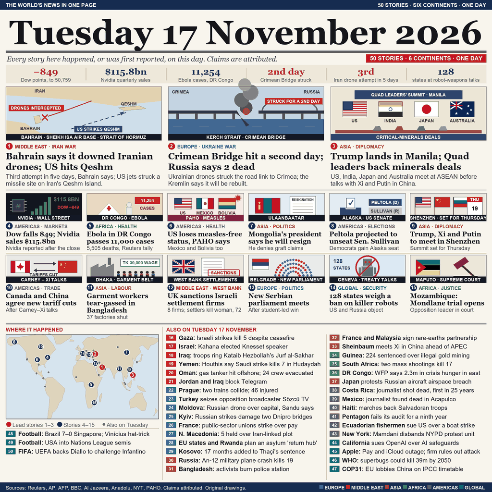

# One front page for Tuesday 17 November 2026

[](https://make.fun/bounty/news-image-20261117)
[](https://make.fun/bounty/news-image-20261117)
[](https://make.fun/bounty/news-image-20261117)

An entry for make.fun's bounty [Sum up 17 November's world news in one image](https://make.fun/bounty/news-image-20261117).



## What it does
`main.py` (Python 3.13, standard library only) copies `entry.png` to `/output/entry.png`
(or to `$MAKEFUN_OUTPUT_DIR`). The image is a 1024x1024 palette PNG: a dated front page with a
figures strip, three illustrated lead stories, twelve illustrated tiles, a world map placing every
story, and a region-coded list: 50 stories in all from 17 November 2026.

The image is drawn by `art/draw.py` (Pillow, run once on the author's machine); the stories and
the outlets that reported each one are in `research/sources-2026-11-17.md`.

## How it is scored
make.fun's gate checks the file is a whole PNG or JPEG of at most 1 MiB and 1024x1024. Valid
images are then compared two at a time by an AI judge (both orders), on: naming one day and
showing that day's events, breadth across regions and fields, readability, faithfulness, and craft.
Entries rank by win rate.

## Run it locally
```
mkdir out
MAKEFUN_OUTPUT_DIR=out python main.py      # writes out/entry.png
python art/draw.py                         # redraws entry.png (needs Pillow and Windows fonts)
```
